  

  <a href="https://dev-sabaree.vercel.app/"><b>Portfolio</b></a>
  &nbsp;·&nbsp;
  <a href="https://github.com/dev-sabaree?tab=repositories"><b>Repositories</b></a>
  &nbsp;·&nbsp;
  <a href="https://github.com/dev-sabaree"><b>GitHub</b></a>

## Hello, I'm Sabareesh

I'm a Computer Science and Engineering student (B.Tech, 2025–2028) with a Diploma in Computer Engineering. I enjoy building mobile, web, and backend software, with a particular interest in Flutter, clean architecture, and AI-powered applications.

I learn by building real projects, and the work below is where that shows.

**Currently focused on**

- Flutter apps with clear architecture and dependable API integration
- Backend services and cloud-backed authentication
- Practical AI-assisted application workflows

## Featured projects

### [Newsilo](https://github.com/dev-sabaree/news)

A Flutter news app built with Clean Architecture and BLoC, featuring Supabase authentication, NewsAPI search, offline caching, and English/Spanish localization. NewsAPI requests run through a Supabase Edge Function, so the API key stays out of the app.

`Flutter` · `Dart` · `BLoC` · `Supabase` · `NewsAPI`

[View repository →](https://github.com/dev-sabaree/news)

### [WeSecure](https://github.com/dev-sabaree/wesecure)

An AI-assisted website-security analysis and learning app that uses the Gemini API to generate security reports, with scan history and a prompt generator.

`TypeScript` · `React` · `Vite` · `Google Gemini API`

[View repository →](https://github.com/dev-sabaree/wesecure)

## Technology stack

| Area | Technologies used in my public work |
| :-- | :-- |
| Languages | `Dart` · `TypeScript` |
| Mobile | `Flutter` · `BLoC` · `GoRouter` |
| Web | `React` · `Vite` |
| Backend & services | `Supabase` (Auth, Edge Functions) · `NewsAPI` · `Google Gemini API` |
| Workflow | `Git` · `GitHub` |

## GitHub contributions

Live data from GitHub. If the graph doesn't load, see the [contribution activity on GitHub](https://github.com/dev-sabaree?tab=overview).

## Connect

- [Portfolio](https://dev-sabaree.vercel.app/)
- [GitHub](https://github.com/dev-sabaree)

  

